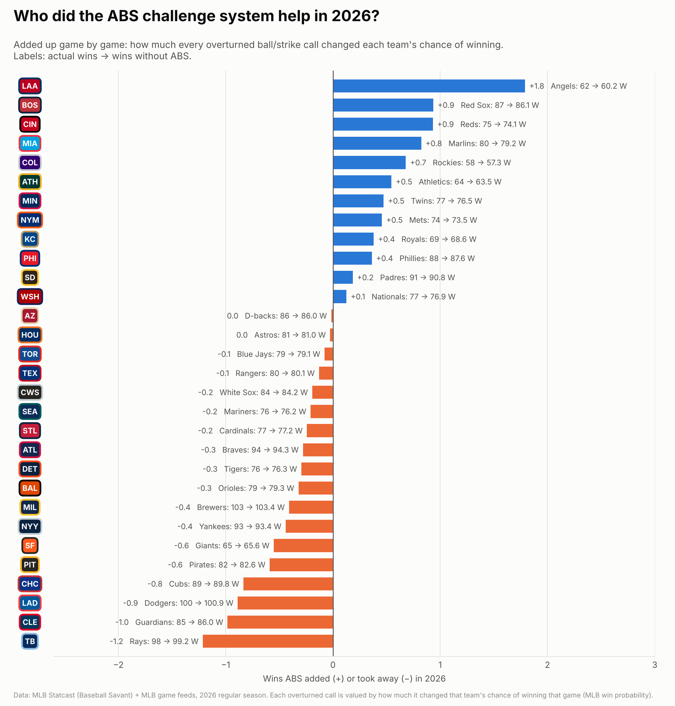
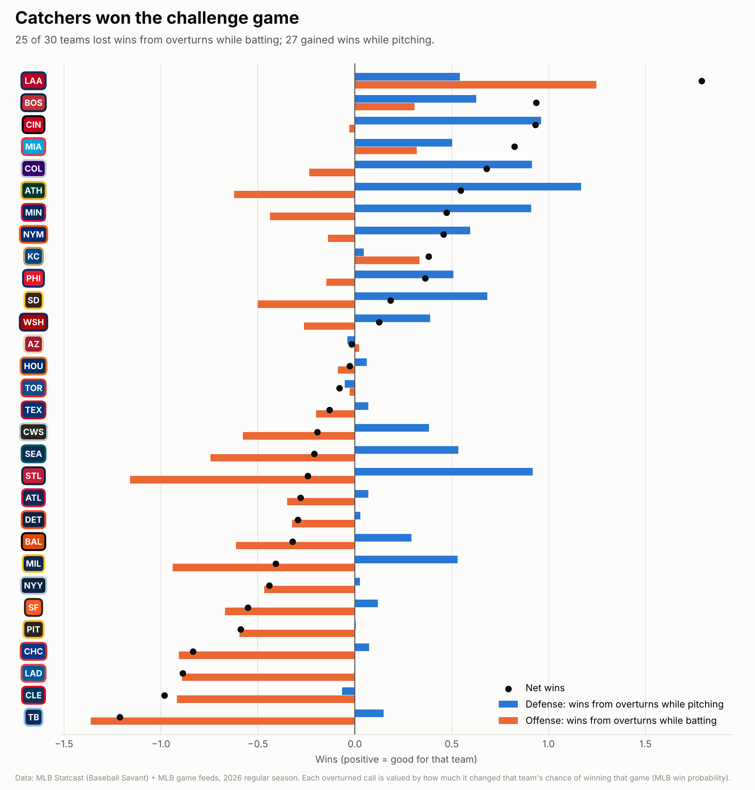
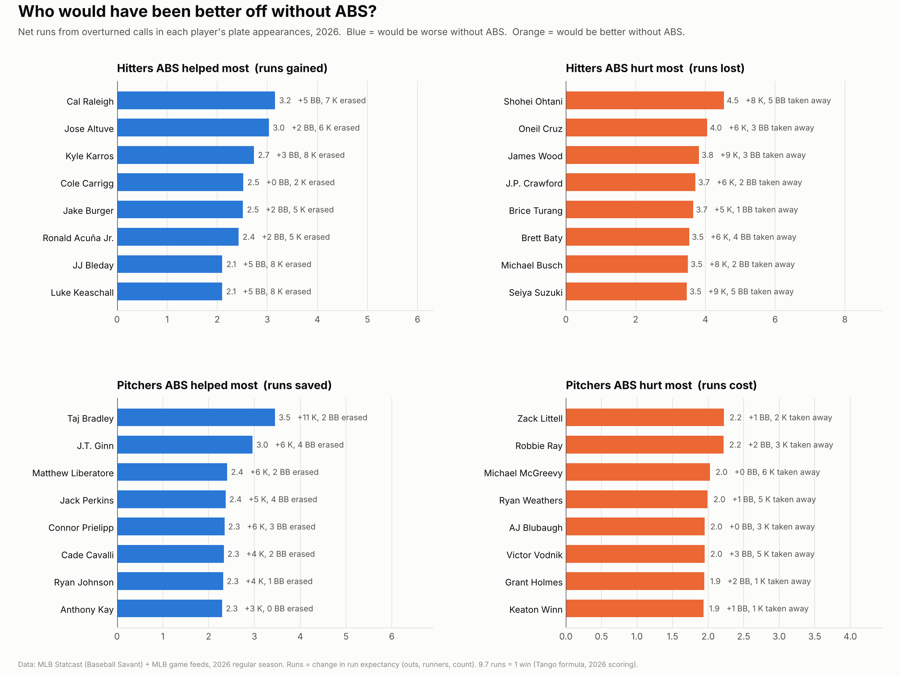

# MLB 2026 without ABS: who did the challenge system help?

In 2026 MLB introduced the Automated Ball-Strike (ABS) challenge system. Each team starts a game with two challenges and keeps a challenge when it wins. In the 2026 regular season teams challenged 10,558 ball/strike calls and 5,686 were overturned.

This project replays the 2026 season with every overturned call put back to the umpire's original call. It measures what each team, hitter and pitcher gained or lost from ABS.



## Key findings

- **Biggest team effects:**
  - Angels: +1.8 wins from ABS (62 wins, about 60 without it)
  - Red Sox and Reds: +0.9 each
  - Marlins: +0.8
  - Rays: −1.2 (98 wins, about 99 without it)
  - Guardians: −1.0
  - Dodgers: −0.9
- **No playoff spot changes.** The tightest race was the Phillies' lead for the last NL wild card, which shrinks from 2 games to 1.6 without ABS.
- **Catchers won the challenge game.** 25 of 30 teams lost wins from overturns while batting, and 27 gained wins while pitching. Across the league, overturns cost offenses about 11 wins. Without ABS there would have been about 280 fewer strikeouts.
- **The Angels were the exception.** They were the only team with a big gain on offense (+1.25 wins), and their overturns came in close, late-game spots.
- **ABS never single-handedly decided a game.** 2,125 of 2,429 games had at least one overturned call. The biggest single swing of the season was 34 points of win probability: a catcher challenge turned a bases-loaded ball four into strike three, tied in the 9th (Rays at White Sox, April 16). Only 11 games had overturns that moved a team's chances by 20+ points.
- **Hitters who would have been better without ABS:** Shohei Ohtani (8 extra strikeouts and 5 walks taken away by catcher challenges), Oneil Cruz, James Wood and J.P. Crawford. **Helped most:** Cal Raleigh, Jose Altuve and Kyle Karros, mostly by challenging strike threes successfully.




## Method

1. **Data.**
   - Every 2026 regular-season pitch from Statcast via Baseball Savant: 717,000 pitches.
   - Every ABS challenge from MLB's game feeds: who challenged, which team, and whether the call was overturned.
   - Matched on game, plate appearance and pitch number. 100% of challenges matched, and the totals agree with MLB's published numbers (10,557 challenges, 54% overturned; Twins 157 of 269 fielding challenges).
2. **Game by game (main method).** Statcast includes MLB's win probability before every pitch. I averaged it over every 2026 pitch to get a team's chance of winning in any situation: inning, score, outs, runners and count. For each overturned call, I compared the team's chance of winning after the overturned call with its chance after the umpire's original call, counting walks, strikeouts, forced-in runs, inning changes and walk-offs. Adding those up by game and by team gives each team's wins from ABS. Because it uses the actual game situation, a call in a tied 9th inning counts far more than one in a blowout.
3. **Cross-check: season runs.** I also valued each call in runs with a 2026 run-expectancy table (outs, runners, count), added them up by team, and converted runs to wins with Tom Tango's formula (the one FanGraphs WAR uses): 1.5 × 4.48 runs per game + 3 = 9.7 runs per win. The two methods agree well (correlation 0.84). They differ most for teams like the Reds and A's, which gained a lot of runs from overturns but mostly when games weren't close. The player chart uses this run-based version, because runs, walks and strikeouts are easier to read at the player level.

## Limits

- These are **expected** wins. Without ABS, every pitch after a flipped call would have been different too, and nobody can know exactly how.
- Failed challenges cost nothing on that pitch. Their real cost is losing a challenge for later in the game, which isn't valued here.
- Win probability for rare situations falls back to broader situations (dropping the count, then the runners) when fewer than 15 pitches in 2026 match.

## Run it

```bash
pip install pybaseball pandas numpy matplotlib requests pyarrow
python get_statcast.py       # every 2026 pitch (a few minutes)
python get_feeds.py          # every ABS challenge from MLB game feeds
python get_standings.py      # 2026 standings
python analysis.py           # run-based values, player tables
python analysis_games.py     # game-by-game win probability (main results)
python charts.py             # charts
```

Data: MLB Statcast via [Baseball Savant](https://baseballsavant.mlb.com) and the MLB Stats API.
